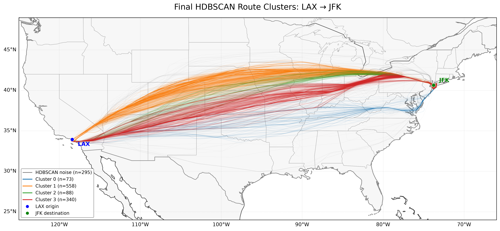
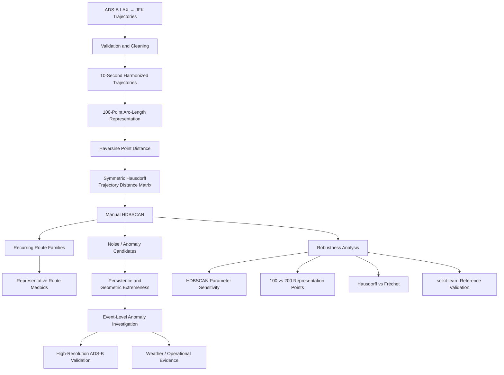
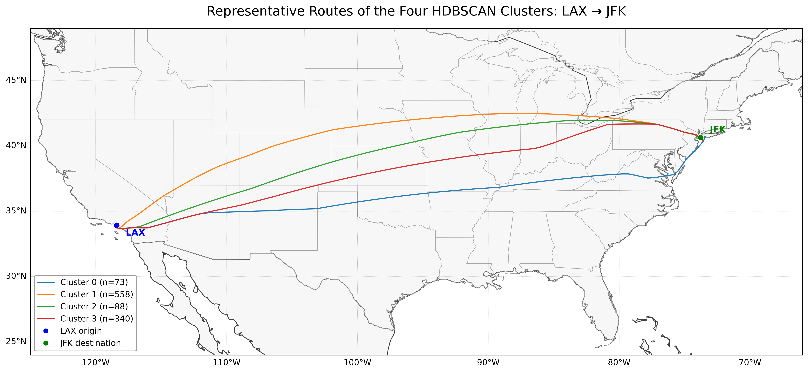
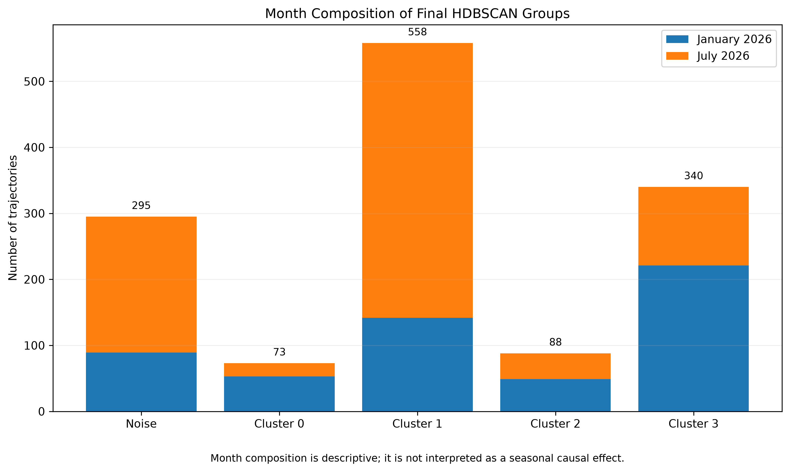
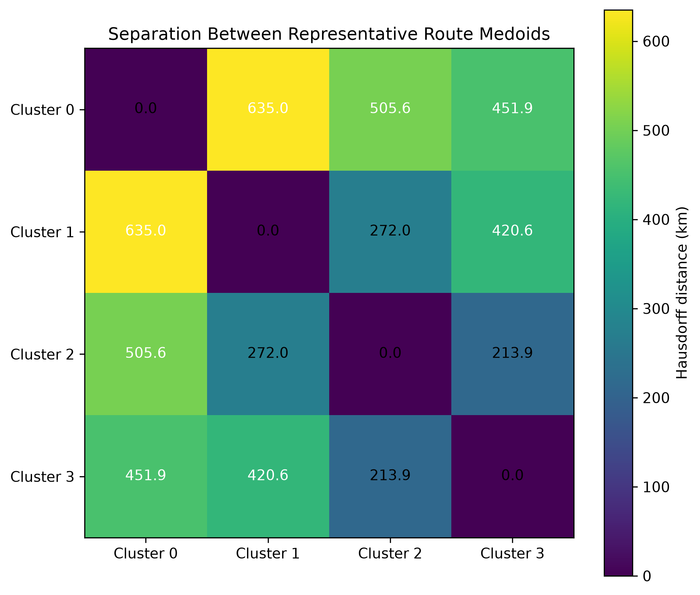
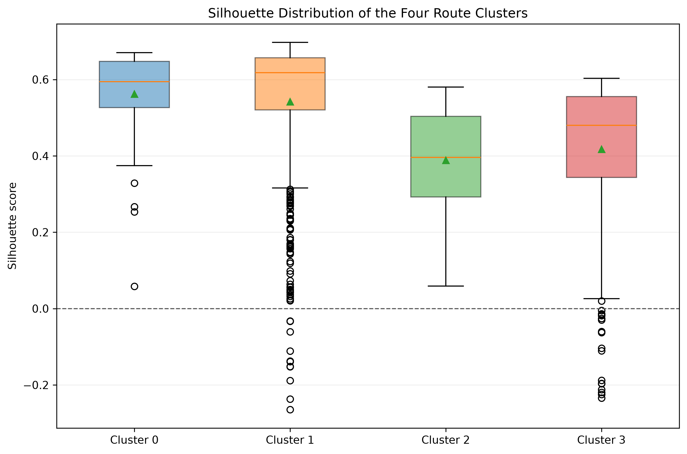

# Flight Trajectory Clustering Using HDBSCAN

**Identifying recurring operational route patterns and anomaly candidates in LAX → JFK ADS-B trajectories**

This project studies complete commercial flight trajectories between Los Angeles International Airport (LAX) and John F. Kennedy International Airport (JFK) using a manually implemented HDBSCAN clustering pipeline.

The clustering methodology and primary route-pattern analysis are complete and validated. The anomaly-investigation stage is still ongoing and is a central part of the research.

---

## Project at a Glance

| Item | Final study configuration |
|---|---|
| Route | LAX → JFK |
| Study months | January 2026 and July 2026 |
| Total trajectories | 1,354 |
| Temporal sampling | 10-second harmonized trajectories |
| Trajectory representation | 100 arc-length points |
| Point distance | Haversine |
| Trajectory distance | Symmetric Hausdorff |
| Clustering | Manual HDBSCAN |
| Final clusters | 4 |
| Clustered trajectories | 1,059 |
| Noise / anomaly candidates | 295 |

Final cluster membership:

```text
Cluster 0:  73 trajectories
Cluster 1: 558 trajectories
Cluster 2:  88 trajectories
Cluster 3: 340 trajectories
Noise:      295 trajectories
```

---

## Final Route Clustering

The primary clustering result identifies four recurring LAX → JFK route families together with trajectories classified as HDBSCAN noise.



HDBSCAN noise is treated as a set of **anomaly candidates**, not as automatic evidence of abnormal or unsafe flight operations.

---

## Methodology

The study treats **one complete flight trajectory as one clustering sample**.



The final clustering is therefore only one stage of the research. The noise trajectories are subsequently examined for persistence, geometric extremeness, data-quality issues, date-level concentration, and possible external operational or meteorological context.

---

## Representative Route Families

For each cluster, one real observed flight is selected as its **medoid**: the trajectory with the minimum mean Hausdorff distance to the other members of that cluster.



Using medoids rather than averaged trajectories ensures that every representative route corresponds to an actual observed flight.

---

## Key Findings So Far

The validated primary clustering produced four recurring route families and 295 HDBSCAN noise trajectories.

The main route-family structure is highly robust:

```text
Manual HDBSCAN vs scikit-learn
    Adjusted Rand Index: 1.000000
    Noise-set Jaccard:   1.000000

100-point vs 200-point representation
    Adjusted Rand Index: 0.989996
    Common-cluster ARI:  1.000000

Hausdorff vs discrete Fréchet
    Adjusted Rand Index: 0.993846
    Common-cluster ARI:  1.000000
```

This indicates that the four major route families are not artifacts of one particular representation resolution, trajectory metric, or HDBSCAN implementation.

The overall silhouette score among clustered trajectories is:

```text
0.490665
```

which supports meaningful route separation while also reflecting overlap and boundary behavior expected in real operational trajectories.

---

## Ongoing Anomaly Investigation

The anomaly-analysis stage is still active and forms an important part of the research.

The final HDBSCAN model identifies:

```text
295 noise / anomaly candidates
```

Of these, 239 remain noise across all three neighboring tested `min_samples` configurations, indicating that many are not merely unstable boundary assignments.

A particularly interesting signal appears on **July 28, 2026**.

Among the 15 primary noise trajectories exceeding the 95th percentile of nearest-medoid distance:

```text
8 occurred on July 28
```

while July 28 accounts for only:

```text
20 of the 1,354 total study trajectories
```

The current interpretation is deliberately limited:

> The unsupervised clustering independently identified an unusually concentrated set of persistent and geometrically extreme trajectories on July 28, 2026. The cause has not yet been established.

The next stage is to validate these trajectories using higher-resolution ADS-B data and independent weather or operational evidence for July 27–29.

No causal weather or operational claim is made at the current stage.

---

## Research Objective

The broader objectives of the study are to:

1. identify recurring LAX → JFK route families;
2. determine representative observed trajectories for those families;
3. identify trajectories that depart from the major recurring patterns;
4. test whether the clustering remains stable under reasonable modeling choices;
5. investigate whether persistent and geometrically extreme trajectories correspond to meaningful operational or environmental events.


## Dataset

Final processed dataset:

```text
January 2026: 554 trajectories
July 2026:    800 trajectories
--------------------------------
Total:       1,354 trajectories
```

Each trajectory is represented by geographic latitude/longitude observations along a complete LAX → JFK flight.

The two months have different source provenance:

- January trajectories were generated from retained higher-resolution source data and processed through the project preprocessing pipeline.
- July trajectories were supplied as approximately 10-second trajectories and harmonized through the project pipeline.

Because of this provenance difference and because only two months are studied, month-level differences are treated as descriptive rather than evidence of a general seasonal effect.

### Month Composition

The final HDBSCAN groups contain different proportions of January and July trajectories.



This comparison is descriptive only. Because the study includes two selected months with different source-data provenance, the figure is not interpreted as evidence of a general seasonal effect.

The raw and processed flight datasets are not stored in the public Git repository.

---

## Methodology

The final primary workflow is:

```text
ADS-B trajectories
        ↓
data validation and cleaning
        ↓
10-second trajectory dataset
        ↓
100-point arc-length representation
        ↓
Haversine point distance
        ↓
symmetric Hausdorff trajectory distance
        ↓
1,354 × 1,354 precomputed distance matrix
        ↓
manual HDBSCAN
        ↓
route clusters + noise/anomaly candidates
        ↓
evaluation and visualization
```

### Trajectory Representation

Every complete flight is represented using:

```text
100 equally spaced points along cumulative trajectory arc length
```

This provides a fixed-length geometric representation while preserving the overall route shape.

A 200-point representation was also evaluated as a sensitivity experiment.

### Trajectory Distance

The primary trajectory distance is:

```text
symmetric Hausdorff distance
```

with point-to-point distances calculated using the Haversine formula.

Discrete Fréchet distance was evaluated independently as a trajectory-metric sensitivity test.

### HDBSCAN

HDBSCAN was implemented manually from the precomputed trajectory-distance matrix.

The implementation includes:

```text
core distances
        ↓
mutual-reachability distances
        ↓
minimum spanning tree
        ↓
single-linkage hierarchy
        ↓
condensed hierarchy
        ↓
cluster stability
        ↓
Excess of Mass cluster selection
        ↓
final labels
```

The manual implementation was validated against `sklearn.cluster.HDBSCAN` using the equivalent `min_samples` convention.

The resulting partition matched exactly.

---

## Final Clustering Configuration

The frozen primary configuration is:

```text
Trajectory sampling:      10 seconds
Representation:           100 arc-length points
Point distance:           Haversine
Trajectory distance:      symmetric Hausdorff
HDBSCAN min_samples:      15
HDBSCAN min_cluster_size: 30
Cluster selection:        Excess of Mass
```

Final result:

```text
Clusters:                 4
Clustered trajectories:   1,059 / 1,354
Noise candidates:           295 / 1,354
Noise percentage:          21.787%
```

Cluster sizes:

```text
Cluster 0:  73
Cluster 1: 558
Cluster 2:  88
Cluster 3: 340
```

---

## Representative Routes

Each cluster is represented using its **medoid**:

> the observed trajectory with the minimum mean Hausdorff distance to the other members of its cluster.

Using medoids ensures that representative routes correspond to real observed flights rather than synthetic averaged paths.

Representative trajectories:

```text
Cluster 0
20260116T220252Z_adde95_JBU1124

Cluster 1
20260111T074405Z_adabfe_JBU324

Cluster 2
20260112T064839Z_a33328_AAL10

Cluster 3
20260131T200523Z_a03765_AAL32
```

---

## Cluster Evaluation

### Silhouette Analysis

Silhouette analysis was performed on the 1,059 clustered trajectories only.

HDBSCAN noise was excluded because it does not form a fifth cluster.

Overall silhouette score:

```text
0.490665
```

Mean silhouette by cluster:

```text
Cluster 0: 0.561794
Cluster 1: 0.541886
Cluster 2: 0.388803
Cluster 3: 0.417695
```

Only 29 of the 1,059 clustered trajectories have negative silhouette scores.


### Representative-Route Separation

The pairwise Hausdorff distances between cluster medoids provide another view of how distinct the four recurring route families are.



The closest representative-route pair is:

```text
Cluster 2 ↔ Cluster 3
Hausdorff distance: 213.922 km
```

The most separated representative-route pair is:

```text
Cluster 0 ↔ Cluster 1
Hausdorff distance: 634.983 km
```

### Silhouette Distribution

The distribution below shows how strongly individual trajectories fit their assigned route family. Most clustered trajectories have positive silhouette values, while a small number near cluster boundaries have negative values.


---

## Robustness and Sensitivity Analysis

Several modeling decisions were evaluated independently.

### HDBSCAN Parameter Sensitivity

Nearby values of:

```text
min_samples
min_cluster_size
```

were tested.

The major route-family structure remained stable across a broad range of configurations.

Most sensitivity occurred at the boundary between clustered trajectories and HDBSCAN noise.

### 100 vs 200 Representation Points

The complete 200-point Hausdorff matrix was constructed and clustered using the same HDBSCAN parameters.

Results:

```text
Overall ARI:                   0.989996
Common-cluster ARI:            1.000000
Noise-set Jaccard:             0.979730
Noise-mask agreement:          0.995569
```

Only six trajectories changed cluster/noise status.

The 100-point representation was therefore retained.

### Hausdorff vs Discrete Fréchet

A complete discrete Fréchet distance matrix was also constructed.

Results:

```text
Pairwise-distance correlation: 0.99992690
Overall clustering ARI:        0.993846
Common-cluster ARI:            1.000000
Noise-set Jaccard:             0.983108
Noise-mask agreement:          0.996307
```

Only five trajectories changed cluster/noise status.

The major four-route structure was unchanged.

Hausdorff was retained because it produced essentially the same clustering structure at substantially lower computational cost.

---

## Anomaly-Candidate Analysis

The final HDBSCAN result contains:

```text
295 noise / anomaly candidates
```

Noise persistence was evaluated across neighboring HDBSCAN configurations.

```text
239 / 295
```

primary noise trajectories remained noise under all three tested neighboring `min_samples` configurations.

The median distance from a noise trajectory to its nearest representative route was:

```text
201.418 km
```

The 95th percentile was:

```text
443.453 km
```

and the maximum was:

```text
799.939 km
```

These results show that many noise trajectories are geometrically far from the recurring route families.

They are still treated as anomaly candidates rather than automatically as operational anomalies.

---

## July 28, 2026 Event Signal

A notable post-clustering observation was found on July 28, 2026.

Among all 1,354 trajectories:

```text
15 trajectories
```

exceeded the 95th percentile of nearest-medoid distance among primary noise candidates.

Of these:

```text
8 / 15
```

occurred on July 28.

July 28 contained only:

```text
20 / 1,354
```

of the complete study trajectories.

The unsupervised clustering therefore independently identified an unusually concentrated set of persistent and geometrically extreme trajectories on this date.

The cause has **not** yet been established.

A separate event-validation study using higher-resolution ADS-B and independent weather/operational information is planned for July 27–29.

---

## Final Visualizations

Final report-ready figures are generated by:

```text
src/visualization.py
```

The final figure set includes:

```text
final_route_clusters_map
final_representative_routes_map
final_month_composition
final_silhouette_distribution
final_medoid_distances
```

Both PNG and PDF versions are generated.

Cluster colors are fixed consistently as:

```text
Cluster 0 = blue
Cluster 1 = orange
Cluster 2 = green
Cluster 3 = red
Noise     = gray
```

---

## Presentation and Result Artifacts

Selected final figures and compact numerical summaries are included in
the repository so the main results can be inspected without rerunning
the full analysis.

### Figures

```text
docs/figures/
├── final_route_clusters_map.png
├── final_representative_routes_map.png
├── final_month_composition.png
├── final_silhouette_distribution.png
└── final_medoid_distances.png
```

### Result Summaries

```text
docs/results/
├── cluster_summary.csv
├── representative_routes.csv
├── evaluation_summary.json
└── validation_summary.json
```


Large raw ADS-B datasets, processed trajectory collections, and
precomputed trajectory-distance matrices are intentionally excluded
from the public repository.

---

## Project Structure

```text
HDBSCAN CLUSTERING/
│
├── data/
│   ├── raw/
│   ├── reduced/
│   └── processed/
│
├── outputs/
│   ├── quality/
│   ├── distances/
│   ├── clusters/
│   └── figures/
│
├── src/
│   ├── config.py
│   ├── data_io.py
│   ├── quality.py
│   ├── preprocessing.py
│   ├── july_validation.py
│   ├── july_preprocessing.py
│   ├── build_processed_dataset.py
│   ├── distances.py
│   ├── build_distance_matrix.py
│   ├── build_distance_matrix_200.py
│   ├── build_frechet_matrix.py
│   ├── hdbscan_manual.py
│   ├── run_manual_hdbscan.py
│   ├── validate_hdbscan_reference.py
│   ├── diagnose_eom_k30.py
│   ├── evaluate_hdbscan_sensitivity.py
│   ├── evaluate_representation_sensitivity.py
│   ├── evaluate_metric_sensitivity.py
│   ├── representative_routes.py
│   ├── anomaly_candidates.py
│   ├── visualize_anomaly_candidates.py
│   ├── inspect_top_anomalies.py
│   ├── analyze_anomaly_dates.py
│   ├── evaluation.py
│   └── visualization.py
│
├── main.py
├── requirements.txt
├── README.md
├── PROGRESS.md
└── .gitignore
```

---

## Environment

The project was developed using Python 3.14.

Create a virtual environment:

```powershell
python -m venv .venv
```

Activate it on Windows PowerShell:

```powershell
.venv\Scripts\Activate.ps1
```

Install dependencies:

```powershell
python -m pip install -r requirements.txt
```

Major dependencies include:

```text
NumPy
pandas
Matplotlib
scikit-learn
Cartopy
```

---

## Running the Project

The repository provides a lightweight command-line interface through:

```text
main.py
```

Running without a command prints the frozen project configuration and available commands:

```powershell
python main.py
```

Show command help:

```powershell
python main.py --help
```

### Reproduce the final manual HDBSCAN clustering

```powershell
python main.py cluster
```

This uses the existing frozen 100-point Hausdorff distance matrix and
reproduces the final manual HDBSCAN partition.

### Validate against scikit-learn

```powershell
python main.py validate
```

This compares the manual implementation with the equivalent
`sklearn.cluster.HDBSCAN` configuration.

The validated primary result gives:

```text
Adjusted Rand Index: 1.000000
Noise-set Jaccard:   1.000000
```

### Run final quantitative evaluation

```powershell
python main.py evaluate
```

This regenerates the final cluster summaries, medoid-separation
statistics, silhouette analysis, and noise-to-medoid geometry.

### Generate final figures

```powershell
python main.py visualize
```

This generates the five frozen final visualizations in both PNG and PDF
formats.

### Run the complete finalized analysis sequence

```powershell
python main.py final
```

This runs, in order:

```text
manual HDBSCAN
        ↓
scikit-learn reference validation
        ↓
final quantitative evaluation
        ↓
final visualization
```

The `final` command intentionally uses existing processed data and the
saved primary distance matrix.

It does **not** automatically rerun:

- raw-data preprocessing;
- construction of the primary trajectory-distance matrix;
- the full 200-point sensitivity distance matrix;
- the full discrete Fréchet sensitivity matrix.

Those computationally expensive research stages remain available as
separate modules.

### Research and Sensitivity Modules

Individual modules can still be executed directly from the project root
when a specific experiment needs to be reproduced:

```powershell
python -m src.<module_name>
```

Examples include:

```powershell
python -m src.evaluate_hdbscan_sensitivity
python -m src.evaluate_representation_sensitivity
python -m src.evaluate_metric_sensitivity
```

Expensive matrix-construction scripts should be run deliberately rather
than as part of the normal project entry point.

## Reproducibility Notes

The source code and configuration are version controlled.

Large ADS-B datasets, generated distance matrices, and most generated outputs are intentionally excluded from Git.

Trajectory ordering is preserved using:

```text
outputs/distances/trajectory_index.csv
```

This ordering defines the rows and columns of trajectory-distance matrices and must remain aligned with clustering labels.

The manual HDBSCAN implementation has been independently validated against scikit-learn.

---

## Limitations

Important limitations include:

- only one origin-destination pair is analyzed;
- only January and July 2026 are included;
- January and July have different source-data provenance;
- clustering currently focuses on horizontal geographic trajectory shape;
- altitude, speed, weather, traffic constraints, and airline procedures are not used as clustering inputs;
- HDBSCAN noise is not equivalent to a confirmed operational anomaly;
- weather or operational causes of unusual trajectories require independent evidence;
- results from two months should not be generalized as complete seasonal behavior.

---

## Current Status

The core clustering study is complete.

Completed stages include:

```text
data validation and preprocessing
trajectory representation
trajectory-distance construction
manual HDBSCAN
reference implementation validation
parameter sensitivity analysis
representative-route extraction
anomaly-candidate analysis
representation sensitivity
trajectory-metric sensitivity
final quantitative evaluation
final geographic visualization
```

The remaining optional extension is the July 27–29 high-resolution event-validation case study.

---

## Project

Course:

```text
Application of Aerospace Artificial Intelligence
```

Topic:

```text
Clustering Flight Trajectories Using HDBSCAN:
Identifying Operational Patterns and Anomalies
```